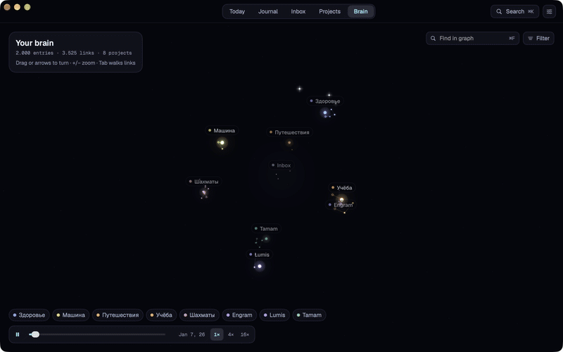
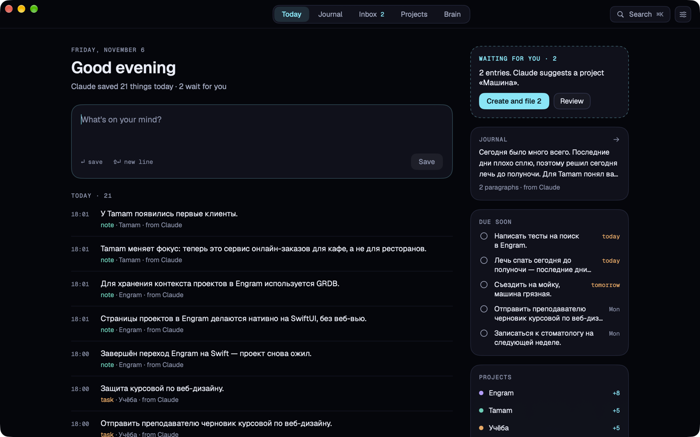
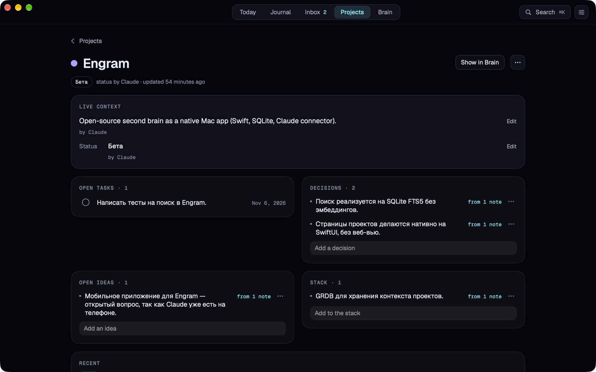
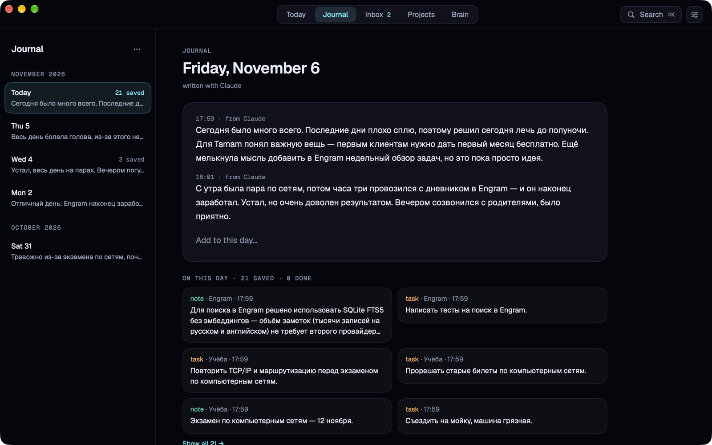
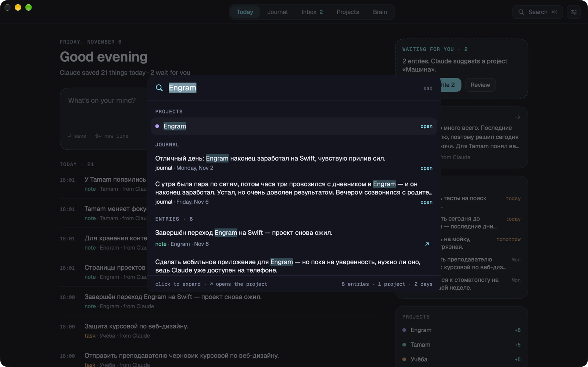

<h1 align="center">Engram</h1>

<p align="center">
  <strong>A second brain that lives on your Mac, and Claude keeps it tidy.</strong><br>
  Think out loud with Claude, say "save this to Engram", and it lands in the right project.<br>
  One app, one SQLite file. No server, no account, no API key.
</p>

<p align="center">
  <a href="https://github.com/m4rkellkka/second-brain-Engram/releases"></a>
  
  
  
  
</p>

<p align="center">
  
</p>

---

Ideas get lost, notes live nowhere, and every AI tool starts from zero about your projects.
Filing things is work, and the payoff comes late, so most systems die in a week.

Engram turns that around: **you just talk.** At the end of a chat in Claude Desktop you say
"save this to Engram", and Claude splits the conversation into tasks, ideas, decisions and
links, files each one into the right project, and keeps every project's page up to date.
Later you ask "what did I decide about search?" and Claude answers from your own notes.

## What it does

- **Save from any Claude chat.** Engram ships a local [MCP](https://modelcontextprotocol.io)
  connector. Claude does the sorting on your Claude subscription, so Engram needs no API key.
- **Today at a glance.** What you saved today, what waits for you, tasks due this week.
- **Projects that remember.** Each project keeps a live page (summary, status, stack,
  decisions, open ideas) that Claude adds to and you can edit. What you write always wins.
- **A journal.** Tell Claude "write to my journal how the day went", or write it yourself.
  Each day sits next to what you saved and finished; later ask Claude how your week felt.
- **A 3D graph of everything.** Filter it, search it with ⌘F, walk it with the keyboard,
  and play a timeline that shows your brain growing.
- **Capture in two seconds.** The menu-bar icon or ⌘N, type, press Return.
- **Search** across entries and journal days with ⌘K, in Russian and English.
- **Your data stays yours.** One SQLite file in `~/Library/Application Support/Engram`,
  and **Export to Markdown** turns it into plain files you can open as an Obsidian vault.

<table>
  <tr>
    <td></td>
    <td></td>
  </tr>
  <tr>
    <td></td>
    <td></td>
  </tr>
</table>

## Install

You need a Mac with **macOS 15 or later** and [Claude Desktop](https://claude.ai/download).

1. Download `Engram-<version>.dmg` from the
   [latest release](https://github.com/m4rkellkka/second-brain-Engram/releases) and drag
   **Engram** into **Applications**.
2. Engram is open source but not notarized by Apple (that needs a paid developer
   account), so macOS blocks it the first time. Either run this once in Terminal:

   ```bash
   xattr -dr com.apple.quarantine /Applications/Engram.app
   ```

   or try to open Engram, then go to **System Settings → Privacy & Security** and click
   **Open Anyway**.
3. Open Engram. It lives in the menu bar too, so closing the window keeps it running.

### Connect Claude Desktop

1. In Engram, open **Settings** (⌘,) and click **Connect to Claude Desktop**.
2. Quit Claude Desktop completely (⌘Q) and open it again.
3. In any chat, say **"save this to Engram"**. Try **"what did I decide about …?"**,
   **"write to my journal how the day went"** or **"sort my Engram inbox"**.

Engram adds itself to `~/Library/Application Support/Claude/claude_desktop_config.json` and
keeps a backup of the old file. If you move `Engram.app`, connect again.

## Keyboard

| Where | Keys |
| ----- | ---- |
| Anywhere | ⌘N new thought · ⌘K search · ⌘1–⌘5 tabs · ⌘, settings |
| Brain | ⌘F find · arrows turn · +/− zoom · 0 fit · 1–9 focus a project · Tab / ⇧Tab walk links · Return open · Esc back |
| Capture and journal | Return saves · ⇧Return new line · Esc cancels an edit |

## Build from source

You need Xcode 26 or later. No Apple Developer account is needed.

```bash
git clone https://github.com/m4rkellkka/second-brain-Engram.git
cd second-brain-Engram
make run        # builds a debug app and opens it
```

Or open `Engram.xcodeproj` in Xcode and press ⌘R.

| Command | What it does |
| ------- | ------------ |
| `make build` | Debug build into `build/DerivedData` |
| `make run` | Build and open the app |
| `make test` | Tests for `EngramKit` and the connector (Swift Testing) |
| `make lint` | `swift format lint --strict` |
| `make format` | Format all Swift sources |
| `make release` | Universal, ad-hoc signed `.zip` and `.dmg` in `build/release` |
| `make demo-graph` | The graph on synthetic data, never your own (`COUNT=10000 PROJECTS=20`) |
| `make eval-connector` | Run sample chats through the connector with the real Claude (needs the `claude` CLI) |
| `make clean` | Remove build output |

Debug builds accept `-EngramDatabasePath <file>` to keep test data away from your real
database. See [CONTRIBUTING.md](CONTRIBUTING.md) before opening a pull request.

## How it fits together

```text
Claude Desktop ──stdio──▶ Engram --mcp ─┐
                                        ├──▶ EngramKit ──▶ engram.sqlite (WAL, FTS5)
Engram.app (SwiftUI, Metal graph) ──────┘
```

The app and the connector are the same binary: Claude Desktop starts `Engram --mcp`, which
talks MCP over stdin/stdout. Both open the same SQLite file in WAL mode, so the connector can
write while the app reads, and the app refreshes as soon as Claude saves.

```text
App/                    SwiftUI app: shell, Today, journal, inbox, projects, Brain, settings
Packages/EngramKit/     EngramKit: schema, migrations, save and context rules, search, export
                        EngramMCP: the tools Claude sees (MCP Swift SDK)
evals/connector/        sample conversations for make eval-connector
scripts/                demo graph and release packaging
Config/Version.xcconfig the app version
docs/                   spec and progress log
```

Swift 6, SwiftUI with small AppKit bridges, Metal for the graph, SQLite through
[GRDB](https://github.com/groue/GRDB.swift), the
[MCP Swift SDK](https://github.com/modelcontextprotocol/swift-sdk), Geist fonts, Swift Testing.

## Roadmap

Engram 1.0 is the first stable release. Next, roughly in this order:

- **One-click connecting** with a Claude Desktop Extension (`.mcpb`)
- **iPhone:** saving from Claude on the phone while the Mac is off
- **Optional in-app sorting** with your own API key, for people without Claude Desktop
- **Global hotkey** and launch at login, **reminders** for due tasks
- **Imports** from Obsidian and Apple Notes; notarized releases and a Homebrew cask

What shipped when: [CHANGELOG.md](CHANGELOG.md). Ideas and bugs:
[open an issue](https://github.com/m4rkellkka/second-brain-Engram/issues/new/choose).

## License

[MIT](LICENSE) © 2026 Mikhail Savushkin. Geist fonts: SIL Open Font License
(`App/Resources/Fonts/OFL-Geist.txt`).
