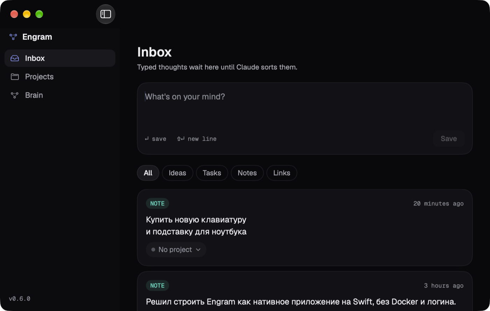

<h1 align="center">Engram</h1>

<p align="center">
  <strong>A second brain that lives on your Mac.</strong><br>
  Think out loud with Claude, say "save this to Engram", and it lands in the right project.<br>
  One app, one SQLite file. No server, no account, no API key.
</p>

<p align="center">
  
  
  
  
  
</p>

<p align="center">
  
</p>

---

> **Work in progress.** Engram is being built in public, one phase at a time.
> Today: capture from the menu bar, an Inbox, search, a Claude Desktop connector that
> saves your conversations, and project pages that keep themselves up to date. The 3D graph is next.

## Why

Ideas get lost, notes live nowhere, and every AI tool starts from zero about
your projects. Manual systems fail because filing is work and the payoff comes late.

- **Capture in under 3 seconds.** Click the menu-bar icon, type or dictate, press Enter.
- **Claude does the thinking.** You talk things through in Claude Desktop; Claude sorts what you said and saves it through Engram's local connector. It runs on your Claude subscription, so Engram itself needs no API key.
- **Projects that remember.** Each project keeps a live context (summary, decisions, open ideas) built from your notes.
- **Local and simple.** Everything is one SQLite file in `~/Library/Application Support/Engram`. No Docker, no cloud.

## Roadmap

| Phase | What                                                    | Status    |
| ----- | ------------------------------------------------------- | --------- |
| 0–5   | Web app (Next.js + Supabase), kept on `web-archive`     | ✅ v0.5.0 |
| 6     | Native foundation: menu-bar capture, Inbox, projects    | ✅ v0.6.0 |
| 7     | Claude connector (MCP) and search                       | ✅ v0.7.0 |
| 8     | Projects with live context                              | ✅ v0.8.0 |
| 9     | Brain graph (3D)                                        | ⏳        |
| 10    | Open-source launch: releases, export, install guide     | ⏳        |

See [CHANGELOG.md](CHANGELOG.md) for what each release contains.

## Build and run

You need a Mac with macOS 15 or later and Xcode 26 or later. No Apple Developer account is needed.

```bash
git clone https://github.com/m4rkellkka/second-brain-Engram.git
cd second-brain-Engram
make run        # builds a debug app and opens it
```

Or open `Engram.xcodeproj` in Xcode and press ⌘R.

### Connect Claude Desktop

1. Open Engram's Settings (⌘,) and click **Connect to Claude Desktop**.
2. Quit and reopen Claude Desktop.
3. In any chat, say **"save this to Engram"**. Ask **"what did I decide about …?"** or **"sort my Engram inbox"** any time.

Engram adds itself to `~/Library/Application Support/Claude/claude_desktop_config.json` (a backup of the old file is kept). If you move `Engram.app`, connect again.

| Command       | What it does                                   |
| ------------- | ---------------------------------------------- |
| `make build`  | Debug build into `build/DerivedData`           |
| `make run`    | Build and open the app                         |
| `make test`   | Tests for `EngramKit` (Swift Testing)          |
| `make lint`   | `swift format lint --strict`                   |
| `make eval-connector` | Save 10 sample chats through the connector with the real Claude (needs the `claude` CLI) |
| `make format` | Format all Swift sources                       |
| `make clean`  | Remove build output                            |

## Project structure

```text
App/                    SwiftUI app: shell, capture, inbox, search, settings, design tokens
Packages/EngramKit/     EngramKit: schema, migrations, save rules, search, tests
                        EngramMCP: the tools Claude sees (MCP Swift SDK)
evals/connector/        sample conversations for make eval-connector
Config/Version.xcconfig the app version
docs/                   spec and progress log
```

## Stack

Swift 6, SwiftUI with small AppKit bridges, SQLite through [GRDB](https://github.com/groue/GRDB.swift) (WAL, FTS5), the [MCP Swift SDK](https://github.com/modelcontextprotocol/swift-sdk), Geist fonts, Swift Testing.

## License

[MIT](LICENSE) © 2026 Mikhail Savushkin. Geist fonts: SIL Open Font License (`App/Resources/Fonts/OFL-Geist.txt`).
