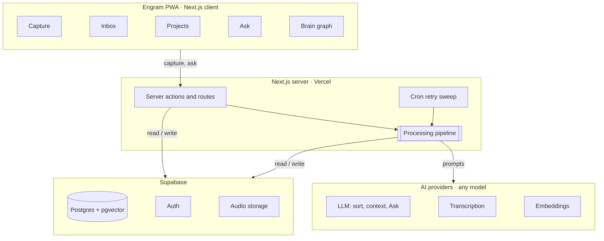

# Engram — MVP Spec

> As of 2026-11-03

## Overview

Engram is an open-source, self-hosted second brain: you dump thoughts by voice or text, and AI files them into the right project and keeps each project's context up to date.

**The problem.** Ideas get lost, notes live nowhere, and every AI tool starts from zero about your projects. Manual systems like Obsidian or Notion fail because filing is work and the payoff comes late.

**Product principles**

- **Capture in under 3 seconds.** Open the app and you are already typing or talking. No folders, tags or required fields.
- **AI does the filing.** Type, project, tasks and due dates are extracted automatically. The user only corrects mistakes.
- **Useful from day one.** Every build phase ships something you use daily.
- **Your data, any model.** Self-hosted on Supabase, configurable LLM provider, one-click Markdown export.
- **Beautiful but quiet.** Dark, minimal UI. The 3D brain graph is the one "wow" element; everything else stays calm.

## MVP scope

The MVP is five screens in one installable PWA, for a single user per self-hosted instance.

| Screen   | What it does                                                       | Key interactions                                      |
| -------- | ------------------------------------------------------------------ | ----------------------------------------------------- |
| Capture  | Instant text or voice input; shows how the last capture was sorted | Tap to talk, type, attach link                        |
| Inbox    | Feed of recent entries, already typed and filed                    | Filter by type, fix project, resolve "not sure" items |
| Projects | Project page with a live context the AI keeps updated              | Edit context, tick tasks, rename, archive             |
| Ask      | Chat with your own notes, answers cite the source entries          | Ask by text or voice, open a cited entry              |
| Brain    | 3D graph of all entries, clustered by project                      | Rotate, hover, click a node to open its project       |

**Out of scope for the MVP:** teams and multi-user hosting, native iOS/Android apps, the MCP server (Phase 9, after the MVP but before 1.0.0), reminders and push notifications, a "Today" screen, calendar/email integrations, iOS share-sheet capture, full offline sync. These are listed under Post-MVP.

## Architecture & stack

One Next.js app (UI + server) on Vercel, Supabase for data, auth and files, and pluggable AI providers called only from the server.



The browser talks only to Next.js (sign-in also goes through a Server Action); API keys and every model call stay on the server.

| Layer           | Choice                                                   | Why                                                                               |
| --------------- | -------------------------------------------------------- | --------------------------------------------------------------------------------- |
| App             | Next.js (App Router), TypeScript strict                  | One codebase for UI and server logic; server actions keep API keys off the client |
| UI              | Tailwind CSS + shadcn/ui, Geist font                     | Fast to build, easy to theme to the mockups                                       |
| PWA             | Web app manifest + service worker                        | Installs to the iPhone home screen, no App Store                                  |
| Data            | Supabase Postgres + pgvector                             | Relational data and vector search in one database                                 |
| Auth            | Supabase Auth (email + password, sign-up disabled)       | No email round-trips, works in the installed iOS PWA and on every device          |
| Files           | Supabase Storage (private bucket)                        | Voice recordings                                                                  |
| AI              | Vercel AI SDK                                            | One interface for Anthropic, OpenAI or local models; structured output with zod   |
| Background work | Next.js `after()` + Vercel Cron sweep                    | Process captures after the response; retry anything stuck                         |
| 3D graph        | react-three-fiber or 3d-force-graph (decided in Phase 7) | WebGL rendering for thousands of nodes                                            |
| Validation      | zod                                                      | Env vars, server action inputs, LLM output                                        |

**Deployment model.** Each user runs their own instance: their own Supabase project and Vercel deployment, with API keys in env vars. This avoids storing other people's keys and keeps the open-source story simple. A hosted multi-user version is a later decision.

## Data model

Four tables: a **capture** is what the user sent (one voice note), and it is split into one or more **entries** (two tasks), each filed into a **project** and linked to similar entries.

```sql
create extension if not exists vector;

create type entry_kind as enum ('idea', 'task', 'note', 'link');
create type capture_source as enum ('text', 'voice');
create type processing_status as enum ('pending', 'processing', 'processed', 'failed');
create type link_kind as enum ('semantic', 'manual');

create table projects (
  id uuid primary key default gen_random_uuid(),
  user_id uuid not null references auth.users on delete cascade,
  name text not null,
  slug text not null,
  color text not null,
  status text,
  context jsonb not null default '{}'::jsonb,  -- { summary, stack[], decisions[], openIdeas[] }
  context_updated_at timestamptz,
  archived_at timestamptz,
  created_at timestamptz not null default now(),
  unique (user_id, slug)
);

create table captures (
  id uuid primary key default gen_random_uuid(),
  user_id uuid not null references auth.users on delete cascade,
  source capture_source not null,
  raw_text text,                 -- typed text or transcript
  audio_path text,               -- Storage path for voice notes
  status processing_status not null default 'pending',
  attempts int not null default 0,
  error text,
  created_at timestamptz not null default now(),
  processed_at timestamptz
);

create table entries (
  id uuid primary key default gen_random_uuid(),
  user_id uuid not null references auth.users on delete cascade,
  capture_id uuid references captures on delete cascade,
  project_id uuid references projects on delete set null,
  kind entry_kind not null,
  content text not null,
  url text,
  due_at timestamptz,
  done_at timestamptz,
  confidence real,               -- AI confidence in kind + project
  needs_review boolean not null default false,
  embedding vector(1536),        -- dimension fixed by the embedding model
  created_at timestamptz not null default now(),
  updated_at timestamptz not null default now()
);

create table entry_links (
  user_id uuid not null references auth.users on delete cascade,
  source_id uuid not null references entries on delete cascade,
  target_id uuid not null references entries on delete cascade,
  kind link_kind not null,
  weight real,
  primary key (source_id, target_id)
);
```

**Indexes.** `entries (user_id, created_at desc)` for the Inbox, `entries (project_id)`, an HNSW index on `entries.embedding` with `vector_cosine_ops`, a partial index on `captures (created_at) where status in ('pending', 'failed')` for the retry sweep, and a full-text index on `entries.content` for hybrid search.

**Security.** Row Level Security on every table with `user_id = auth.uid()` for all operations. Voice files live in a private `audio` bucket at `{user_id}/{capture_id}.<ext>` with matching Storage policies.

**Same-owner references.** RLS only checks a row's own `user_id`, so plain foreign keys would let a user point an entry or link at someone else's row by its id. Every cross-table reference is therefore a composite foreign key on `(id, user_id)` (`entries → projects`, `entries → captures`, `entry_links → entries`), backed by `unique (id, user_id)` on the parent and a matching index. `entries.project_id` uses `on delete set null (project_id)` so only the project column is cleared. Full-text search uses the `simple` configuration because notes mix Russian and English.

**Sign-in.** Email and password, only for the emails listed in `ALLOWED_EMAILS` (one person per instance). Public sign-up is disabled in Supabase Auth itself, so nobody can register through the API with the publishable key; the owner's account is created once in the Supabase dashboard. No emails are sent, which avoids SMTP setup, the built-in hourly email limit and magic links opening in Safari instead of the installed PWA. A forgotten password is reset in the dashboard.

**Embedding dimension.** `vector(1536)` matches OpenAI `text-embedding-3-small`, the proposed default. Switching models means a migration plus a re-embed script, so the model is set once per instance.

## AI pipeline

Every capture runs through the same server-side pipeline after the user already got a response, so capture always feels instant.

1. **Save.** The capture is stored with `status = pending`; the UI returns immediately.
2. **Transcribe** (voice only). Audio from Storage goes to the transcription provider; the transcript becomes `raw_text`.
3. **Sort.** One LLM call with structured output splits the text into entries and assigns kind, project, due date and confidence. It receives the list of existing projects (name, slug, summary) so it can match them.
4. **Review gate.** Entries with confidence below a threshold, or no matching project, get `needs_review = true` and show the "not sure" card in the Inbox.
5. **Embed + link.** Each entry is embedded; the top similar entries above a similarity threshold become `semantic` links for the graph.
6. **Update project context.** For each touched project, a second LLM call gets the current context plus the new entries and returns a small patch (new decision, new idea, updated summary or status), not a full rewrite.
7. **Done.** `status = processed`. Failures set `failed` and increment `attempts`; the cron sweep retries up to 3 times.

Structured output for step 3:

```ts
const SortedCapture = z.object({
  entries: z
    .array(
      z.object({
        kind: z.enum(["idea", "task", "note", "link"]),
        content: z.string(), // cleaned, in the user's language
        projectSlug: z.string().nullable(),
        newProjectName: z.string().nullable(),
        dueAt: z.string().datetime().nullable(),
        url: z.string().url().nullable(),
        confidence: z.number().min(0).max(1),
      }),
    )
    .min(1),
});
```

**Context rules.** The AI appends to lists and proposes summary/status changes; anything the user edited by hand wins and is never overwritten. Every context change keeps a reference to the entries that caused it, so the page can show "updated from these notes".

**Ask (RAG).** The question is embedded, then hybrid search (pgvector cosine + Postgres full-text) returns the top ~12 entries, optionally scoped to a project named in the question. The answer streams back and cites entries by id; the UI renders the citations as source cards.

**Models.** A small, fast model for sorting and context patches; a stronger model for Ask. Both are env-configurable through the Vercel AI SDK. Token usage is logged per call from Phase 3 so cost per capture is known early.

## Build phases

Ten phases, each ending in something working that you can try. Phases 0–8 are the MVP; Phase 9 comes right after it and must ship before the stable 1.0.0. Each phase is built, demoed and explicitly approved before the next one starts.


**Rules for every phase:** stay inside the phase scope, keep `lint`, `typecheck` and `build` green, add tests for logic that can break silently (RLS, pipeline parsing), commit in small conventional commits, and end with a short report: what was built, how to try it, what was left out, open questions.

### Phase 0 — Foundation

Goal: an empty but real app shell that matches the design.

- Next.js App Router, TypeScript strict, pnpm, ESLint + Prettier
- Tailwind + shadcn/ui with the design tokens from the mockups (dark theme, Geist, project colors)
- App shell: desktop sidebar, mobile tab bar, empty routes for Capture, Inbox, Projects, Ask, Brain
- zod-validated env, `.env.example`, Supabase CLI local stack
- GitHub Actions: lint, typecheck, build; MIT license

Done when:

- [ ] `pnpm dev` runs and every route renders in the new shell on desktop and phone width
- [ ] CI is green on push to `demo`

### Phase 1 — Auth & data model

Goal: a secure database you can sign in to.

- Migrations for the schema above, RLS policies, private `audio` bucket
- Generated TypeScript types from the database
- Email + password sign-in, protected routes, sign-out
- Seed script with a few sample projects

Done when:

- [ ] You can sign in on the phone and the laptop
- [ ] A test proves user A cannot read or write user B's rows

### Phase 2 — Text capture, Inbox & PWA

Goal: you can start using Engram as a plain notebook.

- Capture screen: text input focused on open, save with one tap or ⌘Enter
- Each capture creates one `note` entry (no AI yet)
- Inbox feed with type filters and manual project assignment
- PWA manifest, icons, installable on iPhone; optimistic UI

Done when:

- [ ] From tapping the home-screen icon to a saved thought takes under 3 seconds
- [ ] A thought saved on the phone appears in the Inbox on the laptop

### Phase 3 — AI sorting

Goal: captures sort themselves.

- Provider layer on the Vercel AI SDK, models set in env
- Pipeline steps 1, 3, 4 and 7: split into entries, kind, project, due date, confidence
- "Not sure" review cards in the Inbox; corrections saved
- Retry sweep via Vercel Cron; token usage logged per call

Done when:

- [ ] On a fixture set of 20 real captures, at least 17 land in the right project (proposed bar)
- [ ] Cost per capture is measured and written in the phase report

### Phase 4 — Voice capture

Goal: talk instead of type.

- Recording UI from the mockup: big mic button, waveform, timer, stop
- MediaRecorder with format detection (iOS Safari records mp4/aac, others webm), 3-minute limit
- Upload to Storage, transcription, then the normal pipeline

Done when:

- [ ] A 30-second voice note recorded in the iPhone PWA becomes sorted entries in the Inbox

### Phase 5 — Projects & live context

Goal: every project has a page that keeps itself up to date.

- Projects list; project page with summary, stack, decisions, open ideas, tasks
- Context updater (pipeline step 6) with "user edits win"
- Create, rename, recolor, archive; tick tasks

Done when:

- [ ] Talking about a project in a capture updates its page without you opening it
- [ ] A hand-edited field survives the next AI update

### Phase 6 — Search & Ask

Goal: ask your brain anything.

- Embeddings on processing + a backfill script; HNSW index
- Semantic links between entries (pipeline step 5)
- Hybrid search, ⌘K search on desktop
- Ask screen: streaming answers with cited source cards

Done when:

- [ ] "What did I think about X?" answers correctly and cites the right entries on 10 test questions

### Phase 7 — Brain graph

Goal: the 3D graph from the mockup, on real data.

- Pick the library (react-three-fiber vs 3d-force-graph) with a short comparison first
- Nodes = entries, clusters = projects, edges = project membership + semantic links
- Auto-rotate, drag, zoom, hover label, click opens the side panel
- Lighter mobile mode if WebGL performance is poor

Done when:

- [ ] 2,000 nodes stay smooth on the MacBook
- [ ] The graph is usable on the iPhone

### Phase 8 — Open-source launch

Goal: a stranger can set it up and wants to star it.

- README: hook, demo GIF, screenshots, features, stack
- Self-host guide: Supabase project + Vercel deploy, all env vars explained
- Markdown / Obsidian export (one file per entry, front matter, folder per project)
- CONTRIBUTING, issue templates, roadmap section

Done when:

- [ ] Someone who never saw the code gets a running instance from the README in under 15 minutes

### Phase 9 — Claude connector (MCP)

Goal: talk things through with Claude in the Claude app, then say "save this to my second brain".

- Remote MCP server in the Engram app (Streamable HTTP route), so it works in the Claude apps on phone and desktop, including voice mode
- Write tool `save_to_engram`: Claude sends a summary of the conversation (what was discussed, decisions, ideas, tasks); it becomes a normal capture and goes through the sorting pipeline
- Read tools: `search_entries`, `get_project_context`, `list_tasks`, so Claude starts with your context
- Sign-in through OAuth for the connector, scoped to the single user of the instance; every call goes through RLS
- Built on `dev` after the MVP merge; released as `0.10.0`

Done when:

- [ ] In the Claude iPhone app, a voice conversation ends with "save this to Engram", and the summary shows up as sorted entries in the Inbox
- [ ] Asking Claude about a project returns its live context from Engram

## Open source & post-MVP

The repo is public from day one, MIT-licensed, with the README growing phase by phase so launch day is not a rewrite.

**What makes it star-worthy:** a 20-second demo GIF (talk → sorted → graph), one-click Vercel deploy button, a self-host guide that takes under 15 minutes, "bring any model", and "your data stays yours" (Markdown export).

**Post-MVP, in rough priority:**

1. **MCP server.** Moved into Phase 9 (Claude connector), required before 1.0.0.
2. **Today screen.** A morning summary of tasks due, recent ideas and stale projects.
3. **Reminders.** Web push for due tasks.
4. **Capture from anywhere.** An iOS Shortcut and a browser extension that post to the capture API.
5. **Imports.** Obsidian vault and Apple Notes.
6. **Hosted multi-user version.** Only if the project gets traction; needs encrypted per-user API keys and billing.

## Risks & open questions

The biggest risk is not technical: it is the project growing faster than it gets used, which the phase gates exist to prevent.

| Risk                                 | Mitigation                                                                                                 |
| ------------------------------------ | ---------------------------------------------------------------------------------------------------------- |
| Scope creep, the app never gets used | One phase at a time; a phase starts only after the previous one is in daily use                            |
| Wrong sorting erodes trust           | Confidence threshold, "not sure" cards, one-tap correction; corrections can later become few-shot examples |
| LLM cost per capture                 | Small model for sorting, usage logged from Phase 3, batching if needed                                     |
| iOS PWA limits                       | Test on a real iPhone each phase; mp4/aac audio; no share target on iOS, so an iOS Shortcut later          |
| Embedding model lock-in              | Model fixed per instance; re-embed script ships with Phase 6                                               |
| 3D graph performance on phones       | Lighter mobile mode decided in Phase 7                                                                     |

**Open questions**

- [ ] Is the name "Engram" free on GitHub, npm and a domain you like?
- [ ] Default LLM provider for sorting and Ask (Anthropic, OpenAI, or both)?
- [ ] Supabase cloud free tier or local Docker for your own instance?
- [ ] How many hours per week can you put into building?
