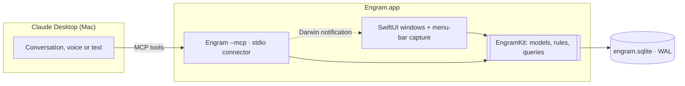

# Engram — Spec (native macOS app)

> As of 2026-11-05. Versions 0.1.0–0.5.0 were a Next.js + Supabase web app; that code lives on the `web-archive` branch. From 0.6.0 Engram is a native macOS app.

## Overview

Engram is an open-source second brain that lives on your Mac. You think out loud with Claude (by voice or text) and say "save this to Engram", or you jot a thought from the menu bar. Engram files everything into the right project, keeps each project's context up to date, and shows it all as a 3D graph.

**The problem.** Ideas get lost, notes live nowhere, and every AI tool starts from zero about your projects. Manual systems like Obsidian or Notion fail because filing is work and the payoff comes late.

**Product principles**

- **Capture in under 3 seconds.** The menu-bar icon opens a capture field from anywhere; Enter saves it. No folders, tags or required fields.
- **Claude does the thinking.** Conversations happen in Claude Desktop; Claude sorts what you said and saves it through Engram's connector. Engram itself needs no API key and costs nothing to run: AI work uses your Claude subscription.
- **Local and simple.** One `.app`, one SQLite file on disk. No Docker, no server, no account, no cloud.
- **Your data, plain and portable.** One-click Markdown export.
- **Beautiful but quiet.** Dark, minimal UI. The 3D brain graph is the one "wow" element; everything else stays calm.

## Scope (MVP)

| Surface          | What it does                                                        | Key interactions                                   |
| ---------------- | ------------------------------------------------------------------- | -------------------------------------------------- |
| Quick capture    | Capture field in the menu-bar popover and in the main window (⌘N)   | Type or dictate (macOS dictation), Enter to save   |
| Today            | The day at a glance: today's entries, what waits for you, capture   | Capture, resolve "not sure", jump to a project     |
| Journal          | One diary page per day, written with Claude or by hand              | "Write this to my journal", edit, see the day      |
| Inbox            | Feed of recent entries; typed thoughts wait here until Claude sorts | Filter by kind, fix project, resolve "not sure"    |
| Projects         | Project page with a live context Claude keeps updated               | Edit context, tick tasks, rename, recolor, archive |
| Search           | ⌘K full-text search over all entries                                | Type, jump to an entry or project                  |
| Brain            | 3D graph of all entries, clustered by project                       | Rotate, hover, click a node to open its project    |
| Claude connector | MCP server that Claude Desktop uses to save and read your brain     | "Save this to Engram", "what's open on project X?" |

There is no Ask screen: asking your brain is a conversation with Claude, which searches Engram through the connector.

**Out of scope for the MVP:** a global hotkey and launch at login, Windows and Linux, an iPhone app, sync between devices, reminders and notifications, imports (Obsidian, Apple Notes), an in-app LLM provider. See Post-MVP.

## Architecture



- **Engram.app** is a SwiftUI app with a main window (Inbox, Projects, Brain) and a `MenuBarExtra` with a capture field.
- **The connector** is the same `Engram` executable started with `--mcp`: then it runs no UI and serves MCP over stdin/stdout. Claude Desktop starts it as a local MCP server. It is a separate process, so it opens the same database file and posts a Darwin notification after each write so the open app refreshes. Reusing the app binary means no second target, no embedding step and no second signature.
- **EngramKit** is a local Swift package with everything both targets share: schema and migrations, save and context rules, search. All logic lives here so it can be tested with `swift test` without the UI.

| Layer        | Choice                                                  | Why                                                                          |
| ------------ | ------------------------------------------------------- | ---------------------------------------------------------------------------- |
| App          | Swift 6, SwiftUI, macOS 15+                             | Native, fast, menu-bar and hotkey support                                    |
| Storage      | SQLite via GRDB.swift, WAL mode                         | Explicit migrations, FTS5 full-text search, safe access from two processes   |
| Connector    | MCP Swift SDK (`modelcontextprotocol/swift-sdk`), stdio | Official SDK; stdio needs no ports, tokens or network                        |
| Search       | SQLite FTS5 (`unicode61`, prefix search)                | Works for mixed Russian and English, no embeddings and no second AI provider |
| 3D graph      | Metal (instanced sprites and lines, additive glow)       | Glow, depth fog and dashes that RealityKit on macOS 15 can't do; 60 fps on 2,000 entries |
| Tests        | Swift Testing in EngramKit                              | Test where bugs live: save rules, context rules, search, MCP input checks    |
| Distribution | GitHub Releases: zipped or DMG `.app`, ad-hoc signed    | No paid Apple Developer account needed; install steps documented             |

**Where the data lives.** `~/Library/Application Support/Engram/engram.sqlite`. The app is not sandboxed (it is not distributed through the App Store), so the connector process and the app can share that file.

**Installing without a paid developer account.** The release is ad-hoc signed but not notarized. After moving `Engram.app` to `/Applications`, the user runs `xattr -dr com.apple.quarantine /Applications/Engram.app` once (or uses System Settings → Privacy & Security → Open Anyway). Building from source in Xcode needs neither. Notarization is a later decision.

## Data model

Single user, so there is no `user_id`, auth or row-level security. Ids are lowercase UUID strings; times are UTC text in GRDB's default `YYYY-MM-DD HH:MM:SS.SSS` format, which sorts correctly and works with SQLite date functions.

```sql
create table projects (
  id text primary key,
  name text not null,
  slug text not null unique,
  color text not null,
  status text,
  summary text,
  summary_source text not null default 'ai',  -- 'ai' | 'user'
  status_source text not null default 'ai',   -- 'ai' | 'user'
  context_updated_at text,
  archived_at text,
  created_at text not null
);

create table captures (
  id text primary key,
  source text not null,         -- 'typed' | 'claude'
  raw_text text not null,       -- typed text, or the conversation summary Claude sent
  conversation_ref text,        -- optional title/date from Claude, for display and dedupe
  content_hash text not null,   -- blocks saving the same summary twice
  status text not null,         -- 'unsorted' | 'sorted'
  time_zone text not null,
  created_at text not null,
  sorted_at text
);

create table entries (
  id text primary key,
  capture_id text references captures on delete cascade,
  project_id text references projects on delete set null,
  kind text not null,           -- 'idea' | 'task' | 'note' | 'link'
  content text not null,
  keywords text,                -- space-separated base forms from Claude, for search and graph links
  url text,
  due_at text,
  done_at text,
  confidence real,
  needs_review integer not null default 0,
  suggested_project text,       -- project name Claude proposes when nothing matches (added in v2)
  created_at text not null,
  updated_at text not null
);

create table project_context_items (
  id text primary key,
  project_id text not null references projects on delete cascade,
  section text not null,        -- 'stack' | 'decision' | 'idea'
  text text not null,
  source text not null,         -- 'ai' | 'user'
  entry_ids text not null default '[]',  -- JSON array of the entries it came from
  dismissed_at text,            -- removed by the user; kept so Claude doesn't add it again (v3)
  created_at text not null
);

create table entry_links (
  source_id text not null references entries on delete cascade,
  target_id text not null references entries on delete cascade,
  weight real not null,
  primary key (source_id, target_id)
);

create table entry_corrections (  -- what the user changed after Claude sorted
  id text primary key,
  entry_id text not null references entries on delete cascade,
  field text not null,
  old_value text,
  new_value text,
  created_at text not null
);

create virtual table entries_fts using fts5(
  content, keywords, content='entries', content_rowid='rowid',
  tokenize='unicode61 remove_diacritics 2'
);
```

**Indexes.** `entries (created_at desc)` for the Inbox, `entries (project_id)`, `captures (status)` for unsorted thoughts, unique `captures (content_hash) where source = 'claude'` (typing the same thought twice is fine), unique `project_context_items (project_id, section, lower(text))` against duplicates.

**Context rules (unchanged from v0.5.0).** Claude appends to lists and proposes summary/status changes; anything the user edited by hand (`source = 'user'`) wins and is never overwritten. Every AI context item keeps the entries it came from, so the page can show "from N notes".

## How thoughts get in

**1. From a Claude conversation (main path).** At the end of a conversation in Claude Desktop the user says "save this to Engram". Claude already understands the conversation, so it does the sorting itself and calls `save_to_engram` with ready entries and context updates. Engram validates them, writes the capture, entries and context items in one transaction, builds keyword links, and the open app refreshes. No second model is involved.

**2. Typed in Engram.** The capture field saves the text instantly as an `unsorted` capture with one `note` entry. Unsorted thoughts are filed when the user asks Claude "sort my Engram inbox": Claude calls `list_unsorted`, then `sort_capture` for each one. Until then they sit in the Inbox as plain notes, so nothing is lost.

**Review gate.** Entries Claude marks with low confidence, or with no matching project, get `needs_review` and show the "not sure" card in the Inbox. Claude never creates projects on its own; it may suggest a name on the card, and creating it is one click. Creating a suggested project files every unfiled "not sure" entry with the same suggestion.

## Claude connector (MCP tools)

| Tool                  | What it does                                                                                                                                                                                      |
| --------------------- | ------------------------------------------------------------------------------------------------------------------------------------------------------------------------------------------------- |
| `save_to_engram`      | Save a conversation summary: `summary`, `entries[]` (kind, content, projectSlug, suggestedProject, dueAt, url, confidence, keywords), optional `conversationRef` and `timeZone`; `contextUpdates[]` arrive in Phase 8. A duplicate summary is reported, not saved again. |
| `list_projects`       | Projects with slug, summary and status, so Claude can match entries                                                                                                                               |
| `get_project_context` | One project's summary, status, open tasks and recent entries; stack, decisions and ideas from Phase 8 |
| `search_entries`      | Full-text search with optional project and kind filters, newest first on ties                                                                                                                     |
| `list_tasks`          | Open tasks, optionally per project or due before a date                                                                                                                                           |
| `update_project`      | Update a project page (summary, status, stack, decisions, ideas) without new entries |
| `complete_task`       | Tick or untick a task by id |
| `list_unsorted`       | Typed thoughts waiting to be sorted                                                                                                                                                               |
| `sort_capture`        | File one unsorted capture, with the same entry shape as `save_to_engram`                                                                                                                          |

Tool inputs are validated in EngramKit: unknown project slugs become `needs_review`, dates must parse, content is trimmed and length-capped. The tool descriptions carry the sorting instructions the Phase 3 prompt used to hold: kinds, local time and time zone for "Friday", one entry per idea or task, the user's language.

**Connecting.** Settings has "Connect to Claude Desktop", which adds `Engram --mcp` to `~/Library/Application Support/Claude/claude_desktop_config.json` (keeping every other setting and saving a backup first). "Disconnect" removes it. The entry points at the app's current location, so moving `Engram.app` means connecting again. A one-click Desktop Extension (`.mcpb`) is planned for Phase 13.

## Build phases

Versions continue from the web app: each shipped phase bumps the minor version. Each phase is planned, built, demoed and explicitly approved before the next starts.


Phases 10–12 were added on 2026-11-06 after Mikhail's feedback on v0.9.1; the open-source launch moved from Phase 10 to Phase 13. Graph bug fixes found then ship first as the patch 0.9.2.

**Rules for every phase:** stay inside the phase scope, keep build, lint and tests green, add tests for logic that can break silently, commit in small conventional commits, and end with a short report.

### Phase 6 — Native foundation (0.6.0)

Goal: a real Mac app you can already use as a quick notebook.

- Replace the web app on `demo` with an Xcode project: app target and `EngramKit` package
- Design tokens from the mockups as SwiftUI colors and styles (dark, Geist, project palette)
- App shell: sidebar with Inbox, Projects, Brain (empty states for the last two); menu-bar icon; closing the window keeps Engram in the menu bar
- SQLite via GRDB with migrations for the schema above
- Capture field in the menu-bar popover and the main window (⌘N): focused on open, Enter saves, Shift+Enter adds a line; saved as an unsorted note
- Inbox: latest entries, kind filter, manual project assignment, create a project inline
- Format/lint (`swift format`), tests, build/test scripts, CI on GitHub Actions (macOS runner, `chore` commits only)

Done when:

- [ ] From clicking the menu-bar icon to a saved thought takes under 3 seconds
- [ ] Thoughts survive quitting and relaunching; no Docker, server or login involved

### Phase 7 — Claude connector + search (0.7.0)

Goal: talk with Claude, say "save this to Engram", and it shows up sorted.

- `Engram --mcp` over stdio with the tools above (MCP Swift SDK); validation and save rules in EngramKit
- "Connect to Claude Desktop" in Settings
- Live refresh of the open app after connector writes (Darwin notification)
- FTS5 search: `search_entries` tool and ⌘K in the app
- Keyword links between entries (≥ 2 shared keywords), stored for the graph
- "Not sure" cards and corrections in the Inbox
- Migration v2: `entries.suggested_project` for the "not sure" card
- Eval: 10 sample conversations saved through the connector by Claude (`claude -p` against a test database), checked by hand

Done when:

- [ ] A conversation in Claude Desktop ends with "save this to Engram", and the summary appears as sorted entries in the Inbox within seconds, without touching Engram
- [ ] "Sort my Engram inbox" files typed thoughts
- [ ] Asking Claude "what did I decide about X?" answers from Engram with the right entries

### Phase 8 — Projects & live context (0.8.0)

Goal: every project has a page that keeps itself up to date (port of v0.5.0).

- Projects list and project page: summary, status, stack, decisions, open ideas with "from N notes", tasks with checkboxes
- `contextUpdates[]` in `save_to_engram`, with "user edits win"
- `get_project_context` and `list_tasks` return the live context
- Create, rename, recolor, archive

Done when:

- [ ] Talking about a project with Claude updates its page without opening it
- [ ] A hand-edited field survives the next update from Claude

### Phase 9 — Brain graph (0.9.0)

Goal: the 3D graph from the mockup, on real data.

- Pick SceneKit vs RealityKit with a short comparison first (chosen: RealityKit, since SceneKit is deprecated)
- Nodes = entries, clusters = projects, edges = project membership + keyword links
- Auto-rotate, drag, zoom, hover label, click opens the project

Done when:

- [ ] 2,000 nodes stay smooth on the MacBook

### Phase 10 — Redesign (0.10.0)

Goal: a new look for every screen: tabs across the top, a dark "constellation" style with glass panels and a cyan accent (directions B + D on the [design canvas](https://claude.ai/artifact/ST8PsDE7JDuKBF2L77DHDD)).

- Mockups of every screen in the chosen style, approved by Mikhail before any code: window with tabs, Today, Journal (built in Phase 11), Inbox, Projects list, project page, Brain chrome, ⌘K, Settings, menu-bar popover, empty and error states
- New design tokens and shared components (glass panel, tab bar, chips, buttons)
- Window shell: tabs Today · Inbox · Projects · Brain centred in the toolbar instead of the sidebar; search and settings on the right; ⌘1…⌘5 switch tabs; the last tab is remembered, Today opens the first time
- Today: today's entries by local day, "not sure" groups, open tasks due soon, capture field, small graph preview; the day's digest lives in EngramKit
- Every other screen restyled; no logic changes

Done when:

- [ ] Every screen matches the approved mockups
- [ ] Tab shortcuts work and the last tab is remembered
- [ ] Today shows today's entries in local time and updates live when Claude saves

### Phase 11 — Journal (0.11.0)

Goal: tell Claude how the day went (or write it yourself) and keep one diary page per day.

- Migration v4: `journal_days` (one row per local day: text, who wrote it last, time zone) with its own FTS5 index
- Rules in EngramKit: Claude only appends a timestamped paragraph and never rewrites what the user wrote; empty input, overlong text and future days are rejected
- Connector tools `write_journal` and `get_journal`; input validated in EngramKit
- Journal tab: list of days, the day's text with editing, "on this day" with the entries and finished tasks of that day; a Today card that leads to it
- Journal days in ⌘K search and as nodes in the Brain graph, linked to the entries of their day
- Eval: two journal conversations added to the connector eval

Done when:

- [ ] "Write to my journal how the day went" in Claude Desktop shows up in the Journal tab within seconds
- [ ] A hand edit of a day survives the next write from Claude
- [ ] Asking Claude "how did I feel last week?" answers from the journal
- [ ] A day is found with ⌘K and is visible in the graph

### Phase 12 — Brain 2.0 (0.12.0)

Goal: a graph you can explore and watch grow.

- Entry kinds drawn differently (tasks as rings, done tasks dim, journal days as stars); cross-project links only on hover or focus; unfiled entries as an "Inbox" nebula
- Filters: projects, kinds, journal days, period; ⌘F search in the graph through FTS
- Labels placed without overlaps; clickable related entries in the side panel
- Keyboard: Esc, arrows, +/−, 0 to fit, 1–9 to focus a project, Tab to the next neighbour
- Timeline slider with play (1×/4×/16×): entries appear in the order they were saved

Done when:

- [ ] The timeline plays 2,000 entries at 60 fps
- [ ] Filters and search narrow the graph without recomputing the layout
- [ ] The graph can be explored with the keyboard alone

### Phase 13 — Open-source launch (0.13.0)

Goal: a stranger installs it and wants to star it.

- README: hook, demo GIF, screenshots, features
- Release workflow: build, ad-hoc sign, zip/DMG, attach to a GitHub Release; install steps including the quarantine command
- Markdown / Obsidian export (one file per entry, front matter, folder per project; journal days as `journal/YYYY-MM-DD.md`)
- CONTRIBUTING, issue templates, roadmap

Done when:

- [ ] Someone who never saw the code installs a release and saves a thought from Claude in under 10 minutes

After Phase 13: merge `demo` into `main`, then `dev` for further work; 1.0.0 when Mikhail calls it stable.

## Post-MVP, in rough priority

1. **Desktop Extension (`.mcpb`)** for one-click connecting, with the Phase 13 release work.
2. **iPhone.** Talking to Claude on the phone while the Mac is off. Open options: a scheduled Claude task that writes into a folder connected through the desktop app (scheduled tasks run in the cloud and reach connected folders only while the desktop app is open), an iCloud Drive inbox folder fed by an iOS Shortcut, or a tunnel to the connector.
3. **Optional in-app sorting** with the user's own API key, for people who don't use Claude Desktop.
4. **Global hotkey** and **launch at login.**
5. **Reminders** for due tasks (the Today screen moved into Phase 10).
6. **Imports.** Obsidian vault, Apple Notes.
7. **Windows.**

## Risks & open questions

- In a test on 2026-11-05 a scheduled Claude task could not see that day's chats (it only read memory), so collecting conversations automatically is not part of the MVP.
- Save quality depends on Claude following the tool descriptions; the Phase 7 eval checks it.
- The biggest risk is still the project growing faster than it gets used, which the phase gates exist to prevent.
